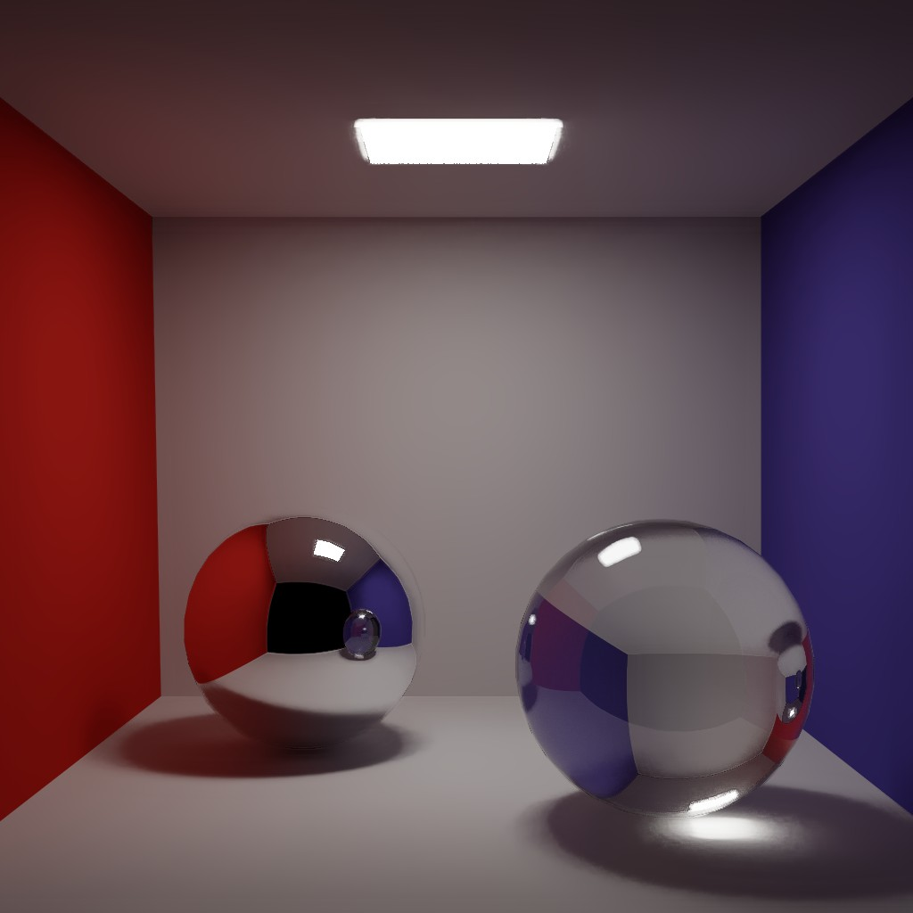
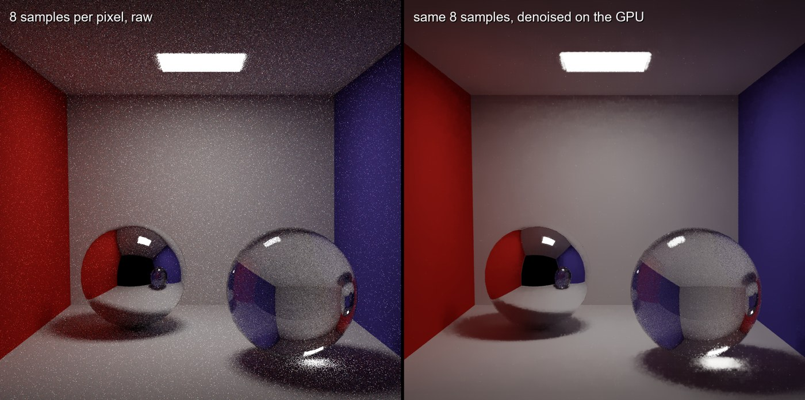
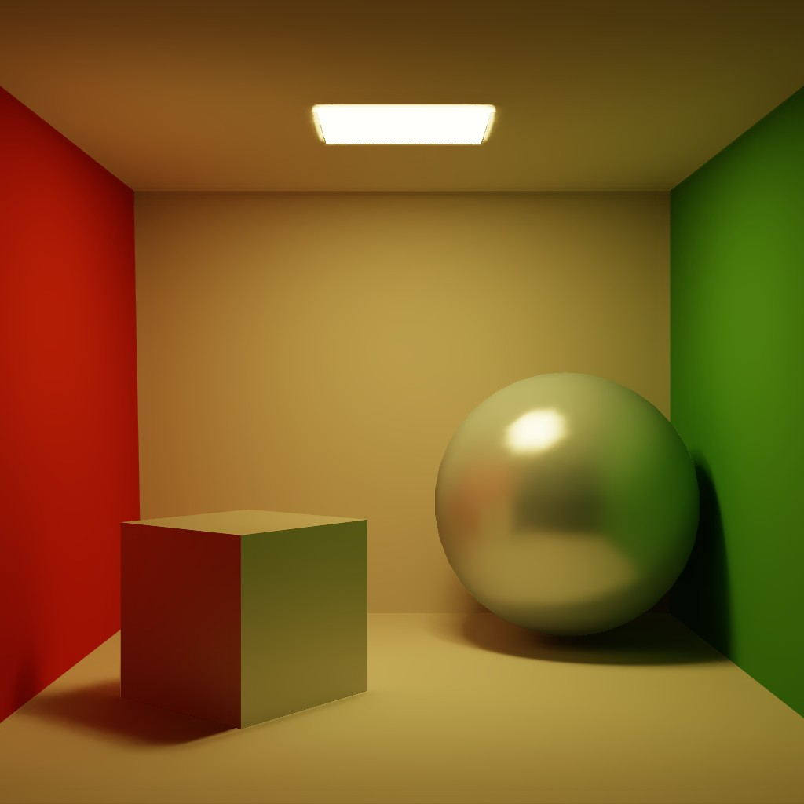
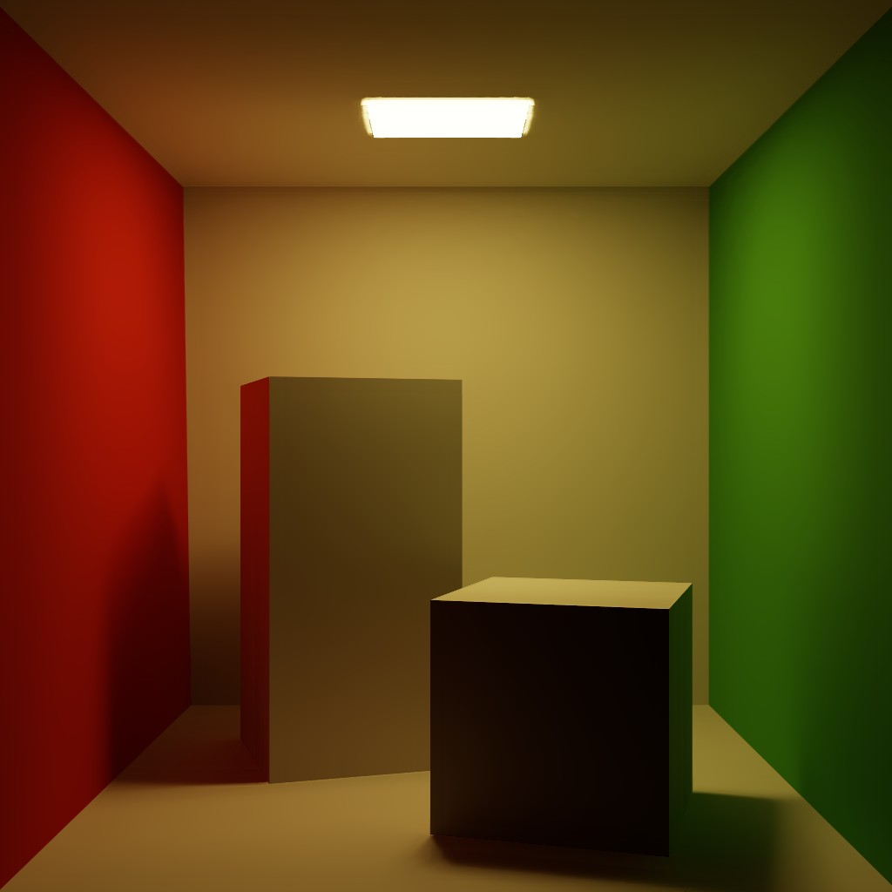
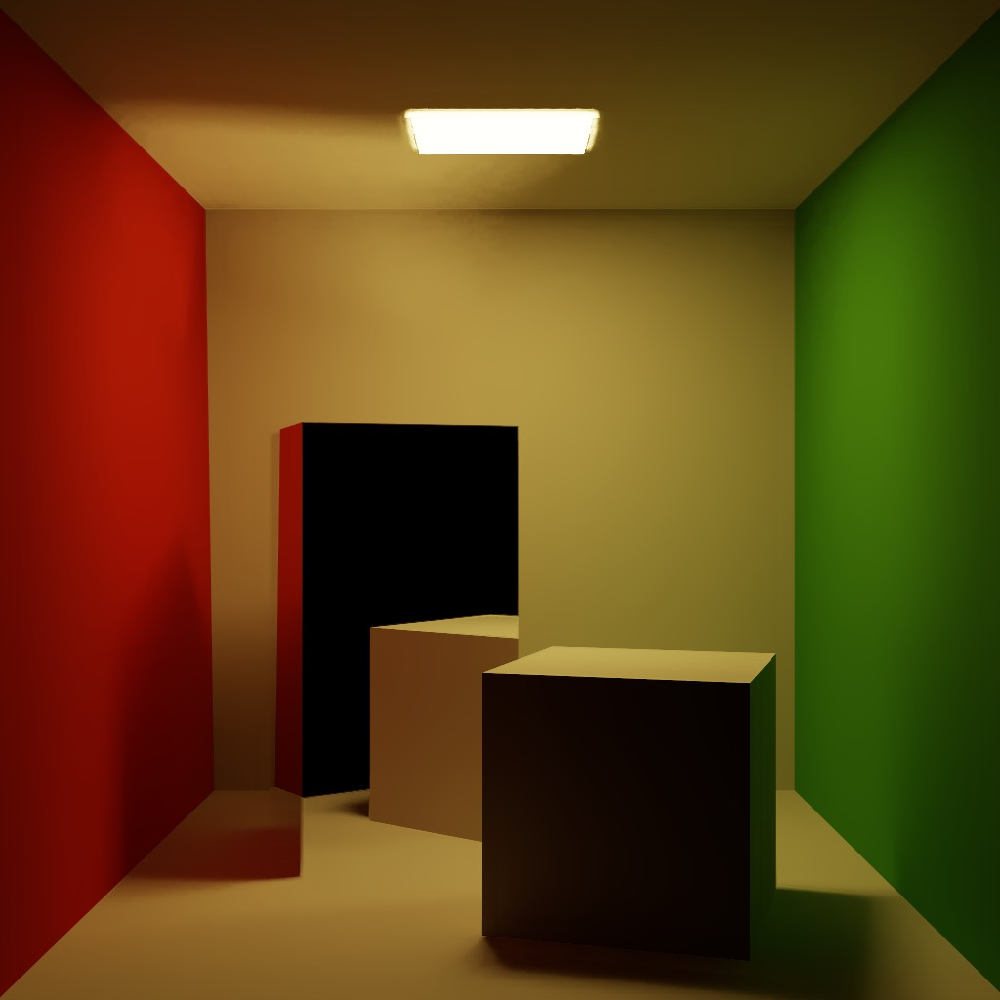

# Vulkan Path Tracer

A physically based path tracer built on Vulkan's hardware ray-tracing pipeline (`VK_KHR_ray_tracing_pipeline`). It renders progressively in a window at interactive rates, with an edge-aware wavelet denoiser running on the GPU, or offscreen to a PNG.



*1024×1024, 2048 samples per pixel, 4.8 s on a laptop RTX 3070. The caustic under the glass sphere comes from the light paths themselves; nothing is faked.*

## Features

- **Hardware ray tracing.** A BLAS/TLAS acceleration structure with raygen, closest-hit and two miss shaders on the RT cores. Shadow rays use `TerminateOnFirstHit | SkipClosestHitShader`, so a visibility test costs almost nothing.
- **Unbiased light transport.** Next-event estimation (one shadow ray to a light per bounce) combined with BSDF sampling through **multiple importance sampling** (power heuristic). Lights are picked in proportion to their area, Russian roulette ends long paths, and ray origins are offset with the Ray Tracing Gems method instead of a fixed epsilon.
- **Materials from MTL.** Lambertian diffuse with cosine-weighted sampling; glossy as Lambert plus an energy-conserving normalized Phong lobe; perfect mirrors; and smooth dielectrics with exact Fresnel, refraction and total internal reflection.
- **Real-time denoising.** An edge-avoiding À-Trous wavelet filter (Dammertz et al. 2010) in five compute passes, guided by albedo, normal and depth buffers. The guides come from the first non-specular hit, so reflections and refractions get denoised too. The colour tolerance follows the local variance, as in SVGF, and fireflies are clamped. Lighting is filtered with the albedo divided out, so surface colour stays sharp.
- **HDR pipeline.** Accumulation in 32-bit float, then an ACES filmic tonemap and sRGB encoding.
- **Interactive viewer.** Move and look around, with accumulation restarting when the camera moves. Live GPU timings (from timestamp queries) show in the title bar.
- **Headless mode.** Renders to PNG with no window or display, and prints throughput. `--compare` also writes the raw image next to the denoised one.

## Denoiser



At 8 samples per pixel the raw image is mostly noise. Five À-Trous passes cover an 81×81 pixel footprint for about 3 ms at 1024². The normal and depth weights keep geometric edges, and the variance-scaled colour weight keeps shadow boundaries.

## Gallery

| | |
|:-:|:-:|
|  |  |
| Glossy sphere and box (Phong lobes) | The original Cornell box |
|  |  |
| Mirror box | Mirror and glass spheres |

All at 1024², 2048 spp, denoised, rendered with `--headless`.

## Performance

Measured on an **NVIDIA RTX 3070 Laptop GPU**, sphere scene, 4 samples per pixel per frame, max depth 8, from GPU timestamp queries:

| Resolution | Trace (4 spp) | Denoise + tonemap | Frame |
|---|---:|---:|---:|
| 512 × 512 | 3.0 ms | 0.8 ms | ~260 fps |
| 1024 × 1024 | 11.1 ms | 3.0 ms | ~70 fps |
| 1920 × 1080 | 21.5 ms | 6.1 ms | ~36 fps |

That is roughly 350–550 million camera paths per second. Each path makes up to 8 bounces plus a shadow ray at every diffuse or glossy vertex.

## How it works

```
                 ┌─────────────────────── per frame ───────────────────────┐
 OBJ + MTL ──► BLAS/TLAS ──► raygen.rgen: N paths/pixel (NEE + MIS)
                              ├─ accumImage   (RGBA32F running mean of radiance)
                              ├─ albedoImage  (first non-specular albedo, light mask)
                              └─ normalDepth  (first non-specular normal + distance)
                                        │
                           atrous.comp × 5 (step 1, 2, 4, 8, 16), ping-pong
                                        │
                           tonemap.comp: × albedo, exposure, ACES, sRGB ──► RGBA8
                                        │
                              blit to swapchain  /  copy to PNG
```

| File | Purpose |
|---|---|
| `shaders/raygen.rgen` | the path tracer: camera rays, BSDF sampling, light sampling, MIS, accumulation |
| `shaders/closesthit.rchit` | fetches the triangle, interpolates the normal, works out which side was hit |
| `shaders/miss.rmiss`, `shadow.rmiss` | escaped path / visible light |
| `shaders/atrous.comp`, `tonemap.comp` | denoiser pass, display transform |
| `src/renderer.cpp` | acceleration structures, pipelines, shader binding table, per-frame commands |
| `src/scene.cpp` | OBJ/MTL loading, material classification, the emissive-triangle list |
| `src/context.cpp` | instance and device; picks a GPU that can actually ray trace |

## Build

Requirements: a GPU and driver with `VK_KHR_ray_tracing_pipeline` (NVIDIA RTX 20-series or newer, AMD RX 6000 or newer, Intel Arc), the [Vulkan SDK](https://vulkan.lunarg.com/) 1.3+, CMake 3.24+, and a C++20 compiler. GLFW, GLM, tinyobjloader and stb are vendored in `external/`.

```sh
cmake -S . -B build -DCMAKE_BUILD_TYPE=Release
cmake --build build --config Release
```

Shaders are compiled to SPIR-V by `glslc` as part of the build. Add `-DVPT_VALIDATION=ON` to enable the Khronos validation layer. The code runs clean under it.

## Run

```sh
# interactive, default scene
./build/vulkan-tracer

# any OBJ with emissive (Ke) materials
./build/vulkan-tracer assets/CornellBox/CornellBox-Glossy.obj

# offscreen: 1024 spp to a PNG, plus the raw image for comparison
./build/vulkan-tracer assets/CornellBox/CornellBox-Sphere.obj --headless --spp 1024 --compare --out sphere.png
```

| Key | Action |
|---|---|
| W A S D / Q E | move / down, up |
| right mouse drag | look around |
| R / F | zoom in / out |
| N | denoiser on/off |
| + / − | exposure |
| P | save `screenshot_N.png` |
| Esc | quit |

Run `--help` for all options: resolution, samples, path depth, camera position and target, field of view, exposure.

## Limitations

- Only mesh lights; there is no environment map, so open scenes render on black.
- Glass blocks shadow rays, so light reaching a surface *through* glass comes only from BSDF-sampled paths. It is correct but converges slowly; the water box needs many more samples than the others.
- One mesh, one instance. The TLAS supports more; the loader doesn't yet.

## Credits

- Cornell box models: Morgan McGuire's [Computer Graphics Archive](https://casual-effects.com/data/) (CC BY 3.0).
- Dammertz, Sewtz, Hanika, Lensch, *Edge-Avoiding À-Trous Wavelet Transform for Fast Global Illumination Filtering*, HPG 2010.
- Schied et al., *Spatiotemporal Variance-Guided Filtering*, HPG 2017 (variance-scaled colour weight).
- Wächter and Binder, *A Fast and Robust Method for Avoiding Self-Intersection*, Ray Tracing Gems (2019).
- The [NVIDIA Vulkan ray tracing tutorial](https://nvpro-samples.github.io/vk_raytracing_tutorial_KHR/) and [Vulkan-Hpp](https://github.com/KhronosGroup/Vulkan-Hpp).
