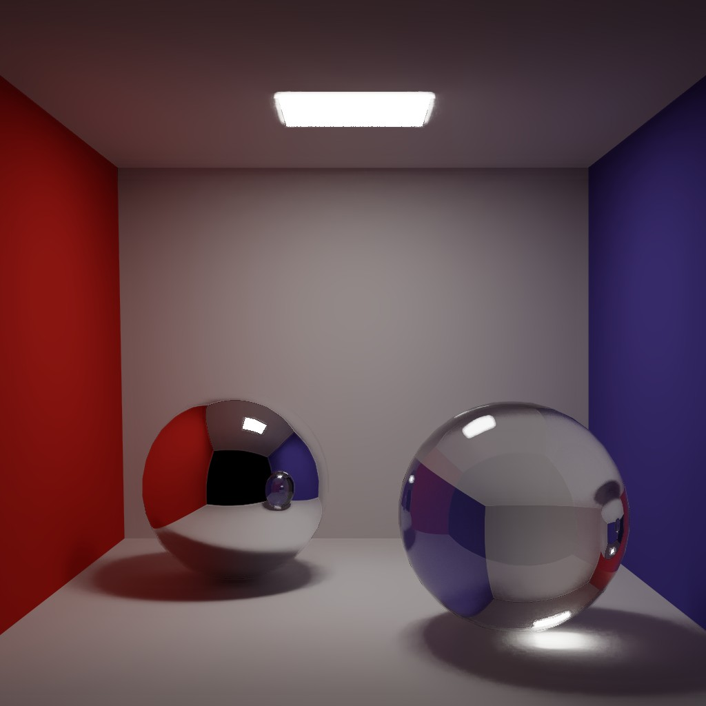
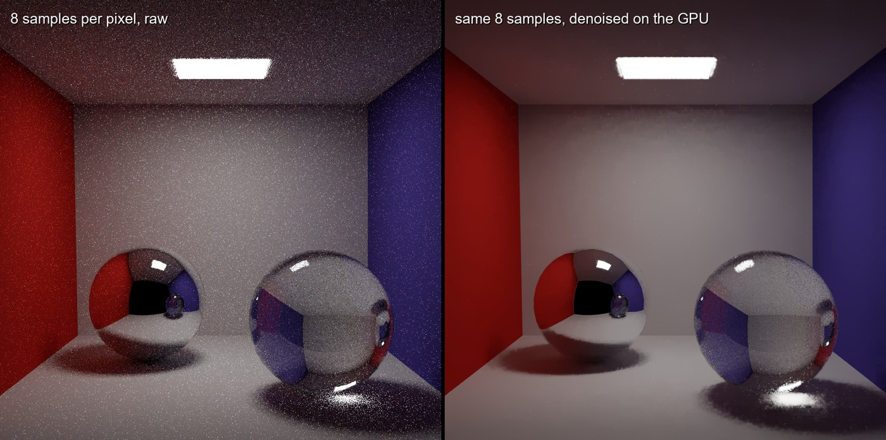
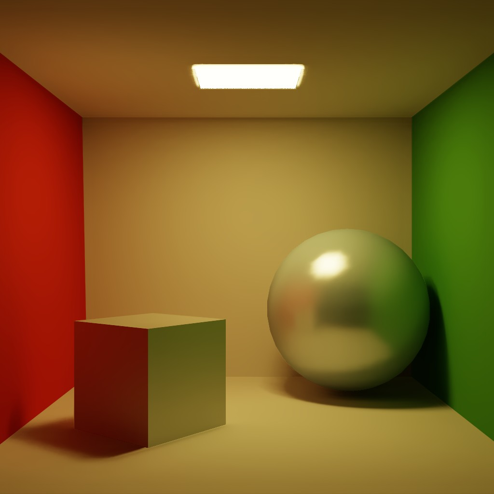
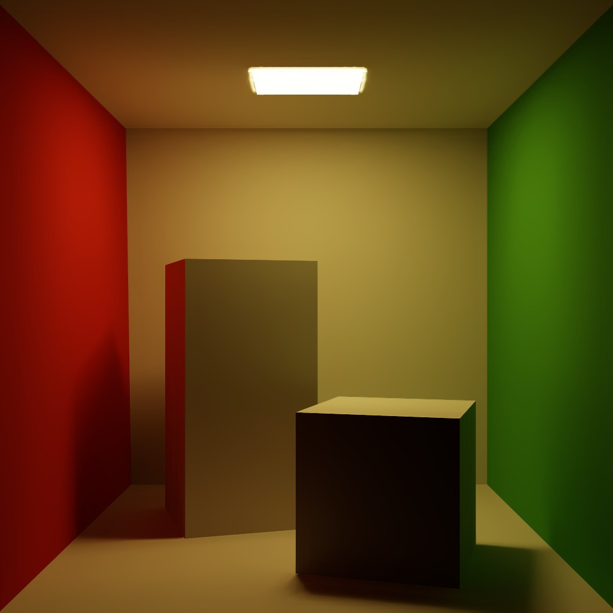
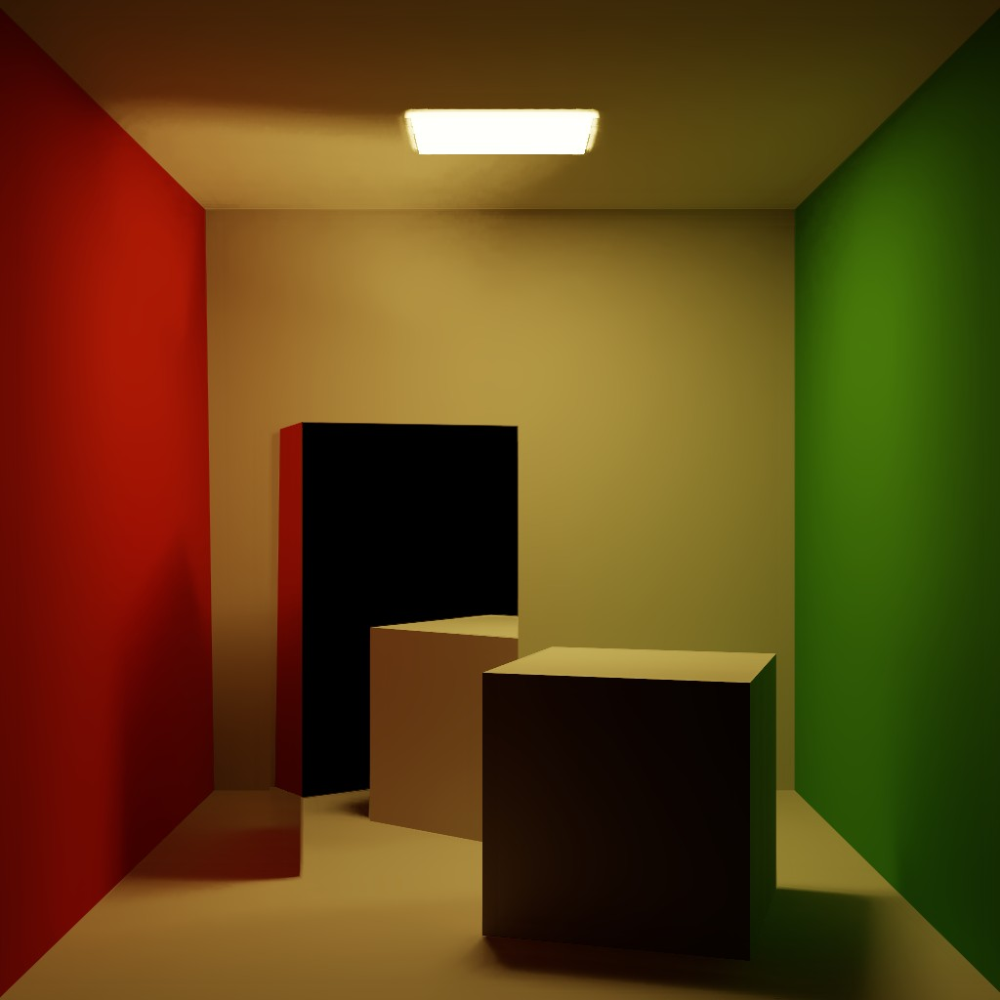

# Vulkan Path Tracer

[](LICENSE)


A physically based path tracer built with **C++23**, **Vulkan-Hpp RAII** (`vulkan_raii.hpp`), **Vulkan Memory Allocator (VMA)**, and Vulkan's hardware ray-tracing pipeline (`VK_KHR_ray_tracing_pipeline`). It renders progressively in a resizable interactive window with a GPU À-Trous + SVGF variance-propagating denoiser, or offscreen to PNG, JPG, or linear float32 HDR.



*1024×1024, 2048 samples per pixel on a laptop RTX 3070. The caustic under the glass sphere comes from the light paths themselves; nothing is faked.*

## Features

- **Modern Vulkan 1.3 / 1.4.** Auto-negotiates Vulkan 1.4 when supported by both SDK and driver (falling back cleanly to 1.3), uses `vulkan_raii.hpp` (no global dispatcher), **VMA** for sub-allocated buffers/images with persistent host mapping, **batched single-submission startup** (`UploadBatch`), `synchronization2` (`vkQueueSubmit2` + fences), and Vulkan 1.4-promoted `VK_KHR_push_descriptor` and `VK_KHR_maintenance5` (inline shader modules).
- **Hardware ray tracing.** A deduplicated-vertex BLAS/TLAS acceleration structure with raygen, closest-hit and two miss shaders on the RT cores. Shadow rays use `TerminateOnFirstHit | SkipClosestHitShader`, and `raygen.rgen` minimises live continuation registers across `traceRayEXT` for high warp occupancy.
- **Unbiased light transport.** Next-event estimation (one shadow ray to a light per bounce) combined with BSDF sampling through **multiple importance sampling** (power heuristic). Area-weighted light selection, exact arbitrary-`--spp` accumulation weighting, Russian roulette, and Ray Tracing Gems ray-origin offsets.
- **Materials from MTL.** Lambertian diffuse with cosine-weighted sampling; glossy as Lambert plus an energy-conserving normalized Phong lobe; perfect mirrors; and smooth dielectrics with exact Fresnel, refraction and total internal reflection.
- **Real-time SVGF-guided À-Trous denoising.** Five compute passes (~2.7–3.7 ms) guided by first non-specular albedo, normal and depth buffers, propagating per-pixel Monte Carlo variance (packed into `accumImage.a`) across passes. Lighting is filtered with the albedo divided out so surface colour stays sharp.
- **HDR pipeline & multi-format output.** Float32 accumulation with ACES filmic tonemap + sRGB encoding for PNG/JPG, or direct linear float32 export to Radiance `.hdr`.
- **Interactive resizable viewer & headless mode.** Live swapchain/render-target recreation on resize, GPU timestamp timings in the title bar, runtime `--validation`, configurable `--clamp`, and `--compare` for raw vs. denoised output.

## Denoiser



At low sample counts the raw image is mostly noise. Five À-Trous passes cover an 81×81 pixel footprint for ~2.7–3.7 ms, guided by normal, depth, and propagated Monte Carlo variance (+4.4 dB PSNR at 128 spp vs. spatial-only variance).

## Gallery

| | |
|:-:|:-:|
|  |  |
| Glossy sphere and box (Phong lobes) | The original Cornell box |
|  |  |
| Mirror box | Mirror and glass spheres |

## Performance

Measured on an **NVIDIA RTX 3070 Laptop GPU** (`--headless --spp 128`, 16 spp/launch, max depth 8, from GPU timestamp queries):

| Scene | Resolution | GPU Trace (128 spp) | Throughput | Final Denoise + Tonemap | Total Wall |
|---|---|---:|---:|---:|---:|
| CornellBox-Original | 1200 × 1200 | 138 ms | 1,333 M paths/s | 3.72 ms | 162 ms |
| CornellBox-Sphere | 1024 × 1024 | 291 ms | 460 M paths/s | 2.71 ms | 316 ms |
| CornellBox-Glossy | 1024 × 1024 | 299 ms | 449 M paths/s | 3.86 ms | 323 ms |

## How it works

```
                 ┌─────────────────────── per frame ───────────────────────┐
 OBJ + MTL ──► BLAS/TLAS ──► raygen.rgen: N paths/pixel (NEE + MIS)
                              ├─ accumImage   (RGBA32F mean radiance + E[L²])
                              ├─ albedoImage  (first non-specular albedo, light mask)
                              └─ normalDepth  (first non-specular normal + distance)
                                        │
                           atrous.comp × 5 (step 1, 2, 4, 8, 16), push descriptors
                                        │
                           tonemap.comp: × albedo, exposure, ACES, sRGB ──► RGBA8
                                        │
                        blit to swapchain  /  export PNG, JPG, or linear HDR
```

| File | Purpose |
|---|---|
| `assets/shaders/raygen.rgen` | path tracer: camera rays, BSDF sampling, NEE, MIS, exact accumulation + second moment |
| `assets/shaders/closesthit.rchit` | triangle fetch, interpolated normal, front-face resolution |
| `assets/shaders/miss.rmiss`, `shadow.rmiss` | escaped path / visible light |
| `assets/shaders/atrous.comp`, `tonemap.comp` | SVGF variance-propagating À-Trous denoiser, ACES + sRGB display transform |
| `src/renderer.cpp` | batched startup uploads, pipelines (`maintenance5`), push descriptors, SBT, frame recording, PNG/JPG/HDR export |
| `src/resources.cpp` | VMA-backed RAII `Buffer`, `Image`, `Accel`, `UploadBatch`, synchronization2 barriers |
| `src/scene.cpp` | OBJ/MTL loading with vertex deduplication (`glm/gtx/hash.hpp`), material classification, light CDF |
| `src/context.cpp` | `vulkan_raii.hpp` instance/device/VMA setup, Vulkan 1.3/1.4 negotiation, discrete GPU selection |
| `src/options.cpp` | C++23 `std::expected` + `std::from_chars` CLI parser and relocatable executable-dir lookup |

## Build

Requirements: a GPU and driver with `VK_KHR_ray_tracing_pipeline` (NVIDIA RTX 20-series or newer, AMD RX 6000 or newer, Intel Arc), the [Vulkan SDK](https://vulkan.lunarg.com/) 1.3+ (includes `glslc`, `vulkan_raii.hpp`, and VMA), CMake 3.24+, and a C++23 compiler (MSVC 19.38+ / VS 2022–2026, GCC 14+, or Clang 18+). GLFW, GLM, tinyobjloader and stb are vendored in `external/`.

```sh
cmake -S . -B build -DCMAKE_BUILD_TYPE=Release
cmake --build build --config Release
```

Shaders are compiled to SPIR-V by `glslc` and synced next to the executable automatically. Pass `--validation` at runtime (or `-DVPT_VALIDATION=ON` at configure time to enable by default) to run under the Khronos validation layer; both core and synchronization validation run clean.

On Linux, GLFW needs the X11 and Wayland development packages (on Debian/Ubuntu: `libxrandr-dev libxinerama-dev libxcursor-dev libxi-dev libwayland-dev libxkbcommon-dev wayland-protocols`, plus `libvma-dev` if VMA is not provided by the Vulkan SDK).

## Run

```sh
# interactive resizable window, default scene
./build/vulkan-tracer

# any OBJ with emissive (Ke) materials
./build/vulkan-tracer assets/models/CornellBox/CornellBox-Glossy.obj

# offscreen: exact spp to PNG, JPG, or linear HDR, plus raw comparison
./build/vulkan-tracer assets/models/CornellBox/CornellBox-Sphere.obj --headless --spp 1024 --compare --out sphere.png
./build/vulkan-tracer assets/models/CornellBox/CornellBox-Original.obj --headless --spp 256 --out original.hdr
```

| Key | Action |
|---|---|
| W A S D / Q E | move / down, up |
| right mouse drag | look around |
| R / F | zoom in / out |
| N | denoiser on/off |
| + / − | exposure |
| P | save `screenshot_N.png` |
| Esc | quit |

Run `--help` for all options: resolution, exact sample count, path depth, firefly clamp, camera position and target, field of view, exposure, and runtime validation.

## Limitations

- Only mesh lights; there is no environment map, so open scenes without emissive materials render black.
- Glass blocks shadow rays, so light reaching a surface *through* glass comes only from BSDF-sampled paths. It is correct but converges slowly; the water box needs many more samples than the others.
- One mesh, one instance. The TLAS supports more; the loader doesn't yet.

## Credits

- Cornell box models: Morgan McGuire's [Computer Graphics Archive](https://casual-effects.com/data/) (CC BY 3.0).
- Dammertz, Sewtz, Hanika, Lensch, *Edge-Avoiding À-Trous Wavelet Transform for Fast Global Illumination Filtering*, HPG 2010.
- Schied et al., *Spatiotemporal Variance-Guided Filtering*, HPG 2017 (variance-scaled colour weight and variance propagation).
- Wächter and Binder, *A Fast and Robust Method for Avoiding Self-Intersection*, Ray Tracing Gems (2019).
- The [NVIDIA Vulkan ray tracing tutorial](https://nvpro-samples.github.io/vk_raytracing_tutorial_KHR/), [Vulkan-Hpp](https://github.com/KhronosGroup/Vulkan-Hpp), and [Vulkan Memory Allocator](https://github.com/GPUOpen-LibrariesAndSDKs/VulkanMemoryAllocator).

## License

The code in this repository is released under the [MIT License](LICENSE). Vendored libraries in `external/` keep their own licenses: [GLFW](external/glfw/LICENSE.md) (zlib), [GLM](external/glm/copying.txt) (MIT / Happy Bunny), [tinyobjloader](external/tinyobjloader/LICENSE) (MIT) and stb_image_write (MIT / public domain). The Cornell box models in `assets/models/CornellBox` are CC BY 3.0 ([details](assets/models/CornellBox/copyright.txt)).
